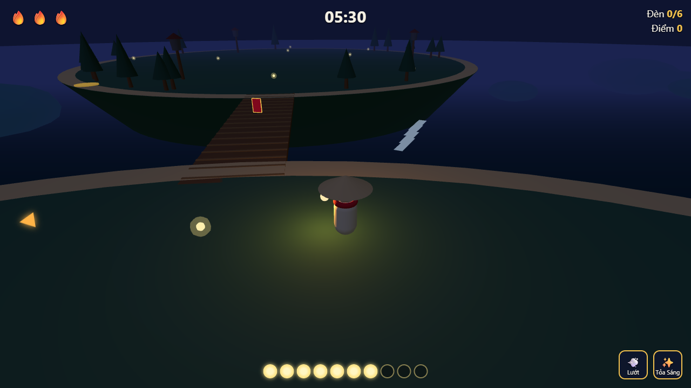

# Đảo Đèn Lồng

> **Phiên bản `v1.0.0`** (Phase 4). **Video demo:** _(chèn link video ở đây)_
> Bài lab Day 12 AI SDLC, cá nhân: Lê Xuân Hà, MSSV 2A202603571. Đề bài: [docs/lab/](docs/lab/README.md). Test Contract **v1.3**. Lịch sử thay đổi từng phiên bản: [CHANGELOG.md](CHANGELOG.md).

Game 3D góc nhìn thứ ba. **Mây**, người giữ đèn nhỏ tuổi, đi qua **3 Đêm** (Đảo Bến, Đảo Cau, Đảo Chuông) gom đom đóm để thắp lại các Đèn Lồng Lớn trước bình minh, đồng thời né **Bóng Mực** và **Gió Lạc**.



## Cài đặt và chạy (3 lệnh)

**Yêu cầu hệ thống:** Node.js ≥ 18; Windows 10+, macOS hoặc Linux; trình duyệt có WebGL 2 (Chrome, Edge, Firefox bản mới); GPU tích hợp là đủ (đo trên Intel Iris Xe). Bench cần Chrome hoặc Edge.

```bash
npm ci
npm run build
npm start          # mở http://localhost:5173 (hoặc mở thẳng dist/web/index.html)
```

**Không muốn cài Node?** Tải `dao-den-long-v1.0.0.zip` ở GitHub Release v1.0.0, giải nén, mở `web/index.html` (bảng xếp hạng khi đó lưu trong trình duyệt). Tạo gói này bằng `npm run package` (ra `release/`).

## Điều khiển

| Phím | Hành động |
|---|---|
| `W A S D` / mũi tên lên-xuống | Đi theo hướng camera (điều khiển được cả trên không) |
| `Space` | Nhảy |
| `Shift` | Lướt: 14 m/s trong 0.2 s, hồi 1.5 s |
| `E` | Nạp ánh sáng vào đèn gần nhất (trong 2 m) |
| `F` | Tỏa Sáng: tốn 3 đom đóm, choáng Bóng Mực trong 5 m, hồi 3 s |
| Kéo chuột / `←` `→` | Xoay camera (độ nhạy chỉnh trong Cài đặt) |
| `Esc` / `P` | Tạm dừng: Tiếp tục / Chơi lại Đêm / Cài đặt / Về menu |
| `Enter` | Chọn nút đang sáng trong menu |
| `F3` | Hiện FPS |

Mọi phím (trừ mũi tên, `P`, `Enter`, `F3`) đổi được ở **Cài đặt → Phím điều khiển**. Gán một phím đang dùng cho hành động khác thì hai hành động đổi phím cho nhau (có cảnh báo). Có nút "Khôi phục mặc định". Lưu qua lần mở sau.

**Trợ năng (Cài đặt):** âm lượng, độ nhạy chuột, bảng màu dễ phân biệt, **giảm chuyển động** (tắt chớp màn hình khi bị chạm), **chữ lớn** (×1.25). Chữ nội dung tối thiểu 18 px. **Phụ đề cho tín hiệu âm thanh** (giữa trên màn hình): Bóng Mực xuất hiện (kèm mũi tên đỏ ở mép màn hình chỉ hướng nó trong 2 s), gió sắp thổi, đếm 10 giây cuối, đèn sắp cạn dầu (fuel < 30, thanh dầu cũng nhấp nháy). Game không có rung camera.

## Luật chơi (số chuẩn Ticket-02, luật Ticket-03)

- **Đom đóm:** nhặt tự động (XZ ≤ 1 m, chênh cao ≤ 1.5 m), mang tối đa 10. Có 20 con lúc đầu, cứ 4 s sinh thêm 1 (trần 30).
- **Đèn lồng:** mỗi đèn cần 10 đom đóm, nạp nhiều lần được. Đèn sáng có **dầu** (tối đa 100, hao 1/giây, hết thì tắt); thắp lại cần 5 đom đóm, đèn chưa đầy nhận châm dầu. Đèn còn ≥ 30 dầu tạo **vùng an toàn 6 m**. Sức chứa tăng 2 mỗi lần thắp thành công (tối đa 20).
- **Bóng Mực:** xuất hiện từ giây thứ 5 (2 con), sau đó cứ 8 / 7 / 6 s thêm 1 con (Đêm 1 / 2 / 3). Thấy Mây trong 12 m thì đuổi, quá 18 m thì bỏ. Chạm vào: −1 Ngọn Lửa, rơi một nửa số đom đóm đang mang ra quanh Mây (nhặt lại được trong 8 s), bất tử 1.5 s.
- **Rơi khỏi đảo:** −1 Ngọn Lửa, mất hết đom đóm, hồi sinh ở điểm xuất phát sau 1 s.
- **Gió Lạc** (Đêm 2, 3): đuổi khi Mây mang ≥ 5 đom đóm, cướp 3 con rồi bỏ chạy. Tỏa Sáng trúng thì nó thả lại đồ đã cướp.
- **Bùa Gió** (Đêm 2, 3): 10 s chạy 7.2 m/s và lướt không hồi chiêu.
- **Đêm 3:** đảo 3 tầng (lên tầng 1 bằng dốc, lên tầng 2 bằng bục nhảy), có gió mạnh mỗi 30 s.
- Bóng Mực tìm đến đèn đang sáng mà dầu dưới 30 và **hút dầu** (5/giây) khi đứng trong 2 m; Mây đến gần trong 6 m thì nó bỏ đèn quay sang đuổi.
- Ngọn Lửa hồi đầy mỗi Đêm. **Thắng:** còn sống lúc bình minh (240 / 270 / 300 s) và số đèn đang sáng ≥ 60% tổng số đèn. **Thua:** hết Ngọn Lửa, hoặc bình minh mà không đủ đèn sáng.

| Điểm | |
|---|---|
| Mỗi đom đóm **nạp** vào đèn | +5 |
| Thắp đèn lần đầu / thắp lại | +100 / +40 |
| Mỗi Bóng Mực trúng Tỏa Sáng (đang hút dầu) | +5 (+15) |
| Bình minh: mỗi đèn đang sáng | +50 + phần nguyên số dầu còn lại |
| Bình minh: mỗi Ngọn Lửa còn lại | +50 |

Tổng điểm game là tổng điểm các Đêm đã thắng.

## Bảng xếp hạng

Sau khi thua một Đêm hoặc sau màn Bình Minh, bấm "Lưu vào bảng xếp hạng" và nhập tên (3–12 ký tự `A-Z 0-9 _`). Điểm lưu là tổng điểm các Đêm đã thắng (Đêm đang thua không tính). Xem từ menu: **Bảng xếp hạng** (top 10, cùng điểm thì ai đạt trước xếp trên).

- Khi chạy `npm start`: lưu ở `data/leaderboard.json` qua `/api/leaderboard` (máy chủ kiểm tra dữ liệu trước khi ghi). Mở thẳng file `dist/web/index.html` thì lưu trong `localStorage` của trình duyệt.
- Xuất: `npm start -- --export-leaderboard out.json` → `{"entries":[{"name","score","nights_won","achieved_at","seed"}]}`.

## Chế độ headless (Test Contract v1.3)

Khai báo ở [`game.contract.json`](game.contract.json). Sau `npm ci && npm run build`:

```bash
node dist/headless.cjs --seed 42 --night 1 --ticks 600 --out out.jsonl \
  [--scenario scenario.json] [--inputs inputs.json] [--snapshot-every 10]
```

- `--night` nhận 1, 2 hoặc 3. Chạy 60 tick/s cố định, không cửa sổ. Một Đêm đầy đủ (21.600 tick) mất khoảng 0.2 s.
- File inputs/scenario sai định dạng thoát với mã `2`. Tham số dòng lệnh sai thoát với mã `1`.
- Snapshot v1.1 có `night`, `wind`, `player.{vel, grounded, invuln, dash_cd_s, pulse_cd_s, charm_s}` và các mảng `motes`, `drifters`, `charms`. Scenario nhận đủ các trường v1.1. Input có `dash` và `pause`.
- `night_start` được ghi ngay sau snapshot tick 0.
- Tất định: PRNG `mulberry32(seed)`. Cùng đầu vào thì output giống hệt nhau.
- Mọi khái niệm trong `tuning` đều có trong game nên không có `null`. Các giả định cho chỗ ticket chưa nói rõ (quy ước góc, điểm xuất phát Đêm 3, thời gian `spawning`…) nằm ở [docs/notes/phase-2.md](docs/notes/phase-2.md).

## Bench và soak (Contract v1.3)

```bash
npm run build
node scripts/bench.mjs --seed 42 --duration 30 --out bench.json   # bench_cmd (cần Chrome hoặc Edge; đặt CHROME_PATH nếu ở chỗ khác)
node --no-opt --max-semi-space-size=1 dist/headless.cjs --soak --seed 7 --nights 10 --out soak.json # soak_cmd
```

- **Bench:** mở game trong Chrome headless ở 1280×720 với `?bench=1`: Đêm 1, 200 Bóng Mực, 100 đom đóm, 3 đèn sáng, camera bay vòng (bán kính 30 m, cao 15 m, 15 s/vòng, ngược chiều kim đồng hồ). Bỏ 3 s khởi động rồi đo. Ghi `avg_fps`, `p1_low_fps`, `frame_ms_p95`, `load_ms`, `peak_mem_mb`, `renderer`, `os`… Ngưỡng: avg ≥ 60, 1% low ≥ 30, load ≤ 10 s. Mây đứng yên ở (0,0,0); trong cảnh bench không sinh thêm thực thể, không sát thương, không hao dầu, không kết thúc Đêm.
- **vsync:** Chrome headless không gắn với màn hình nên khung hình không bị khóa theo tần số quét; bench còn chạy với `--disable-gpu-vsync --disable-frame-rate-limit` → `vsync_off: true`.
- **`peak_mem_mb` = `null`:** ticket định nghĩa là RSS của tiến trình. Trang web không đọc được RSS của trình duyệt, còn đo RSS từ bên ngoài trong lúc chạy thì làm khựng khung hình. Vì vậy ghi `null` và kèm `js_heap_peak_mb` (đỉnh JS heap của trang, lấy mẫu 1 lần/giây ngay trong trang) để tham khảo.
- **Soak:** chạy 10 Đêm liên tiếp trong một tiến trình với input ngẫu nhiên tất định, ghi `nights`, `crashes`, `results`, `mem_start_mb` (RSS ngay sau khi tải xong Đêm đầu), `mem_end_mb` (RSS sau khi bỏ Đêm cuối), `duration_s`. Đạt khi 0 crash và RAM cuối ≤ 1.2 × RAM đầu.
- **Vì sao soak có cờ `--no-opt --max-semi-space-size=1`:** tiến trình Node rất nhỏ (~36 MB), và V8 nở thêm ~10 MB một lần (mã JIT tối ưu, young-generation) trong Đêm đầu, đủ vượt 20% dù không có rò rỉ: heap thật sau GC đứng yên 4.4–4.7 MB qua 10 Đêm, RSS đứng yên ~46 MB từ Đêm 10 tới Đêm 30. Hai cờ này bỏ tầng tối ưu JIT và thu nhỏ young-generation, không đổi luật hay output. Rò rỉ thật (heap tăng mãi) vẫn bị phát hiện.
- Kết quả trên máy em (i5-1135G7, Iris Xe, cắm sạc): avg **111 FPS**, 1% low **63**, load **1.4 s**; soak 0 crash, RSS 35.9 → 40.3 MB (+12%). Lần chạy bench đầu tiên sau khi build thường thấp hơn (1% low có lần ~29), các lần sau ổn định. Chi tiết: [docs/notes/phase-4.md](docs/notes/phase-4.md), [bench.json](docs/proof/phase-4/bench.json), [soak.json](docs/proof/phase-4/soak.json).

## Test và kiểm chứng

```bash
npm test                      # build + typecheck + unit + CLI (gồm đo hiệu năng headless) + mọi scenario headless
npm run verify                # chạy lại scenario mọi phase qua lệnh headless thật, ghi docs/proof/phase-N/
node scripts/screenshot.mjs   # ảnh chụp game (Chrome/Edge headless)
npm run bench                 # đo FPS thật ở 1280x720 (ghi docs/proof/phase-2/fps.md)
```

- Scenario: [`tests/scenarios/`](tests/scenarios/), sinh từ [`gen-specs.mjs`](tests/scenarios/gen-specs.mjs). 42 spec qua 3 phase; spec cũ bị luật mới thay đều có trường `changed` ghi lý do.
- Báo cáo: [Phase 1](docs/proof/phase-1/report.md), [Phase 2](docs/proof/phase-2/report.md), [Phase 3](docs/proof/phase-3/report.md), [Phase 4: bench, soak, ảnh](docs/proof/phase-4/).
- CI (Ubuntu + macOS) chạy test, verify, rồi so bằng chứng đã commit với output thật.

## Cấu trúc

```text
src/sim/      luật game thuần, tất định: tuning.ts (số chuẩn), maps.ts (3 bản đồ chuẩn), sim.ts (12 bước/tick)
src/cli/      lệnh headless
src/web/      bản 3D Three.js: world.ts (địa hình, mô hình), main.ts (luồng 3 Đêm, HUD, tạm dừng, cài đặt), sfx.ts (âm thanh)
tests/        unit, CLI, scenario headless theo phase
scripts/      build, serve (+ API bảng xếp hạng), verify, screenshot, bench (bench_cmd), bench-fps, hooks
data/         leaderboard.json (tạo khi có người lưu điểm, không commit)
docs/notes/   giả định, tiêu chí nghiệm thu, đánh giá, nhật ký AI
docs/proof/   bằng chứng sinh tự động
AGENTS.md, CLAUDE.md, .claude/   harness AI
```

## Sáng tạo của tôi

Mọi phần dưới đây chỉ nằm trong `src/web/` và không làm đổi output headless (bằng chứng: toàn bộ scenario và kiểm tra tất định vẫn đạt).

1. **Âm thanh tạo bằng code (WebAudio, không dùng file):** nhạc nền mỗi Đêm một giọng, tiếng "ting" nhặt đom đóm cao dần theo số đang mang, tiếng báo gió, tiếng Gió Lạc cướp đồ, tiếng đếm ngược.
2. **Ông Đăng:** mỗi Đêm có một lời dặn riêng ở màn giới thiệu.
3. **Hiệu ứng nhỏ:** Bóng Mực lớn dần khi đang `spawning`, đom đóm rơi nhấp nháy khi sắp tan, lá bay theo hướng gió 2 s trước cơn gió, tháp chuông có chuông vàng.

Ảnh: [`docs/proof/phase-2/screenshots/`](docs/proof/phase-2/screenshots/).

## Ghi chép

- Phase 1: [docs/notes/phase-1.md](docs/notes/phase-1.md) · Phase 2: [docs/notes/phase-2.md](docs/notes/phase-2.md) · Phase 3: [docs/notes/phase-3.md](docs/notes/phase-3.md) · Phase 4: [docs/notes/phase-4.md](docs/notes/phase-4.md)
- Nhìn lại cả dự án: [docs/notes/retro.md](docs/notes/retro.md)
- Nhật ký dùng AI và token: [docs/notes/ai-log.md](docs/notes/ai-log.md)
- Giấy phép: [LICENSE](LICENSE) (MIT). Nguồn: [CREDITS.md](CREDITS.md)
