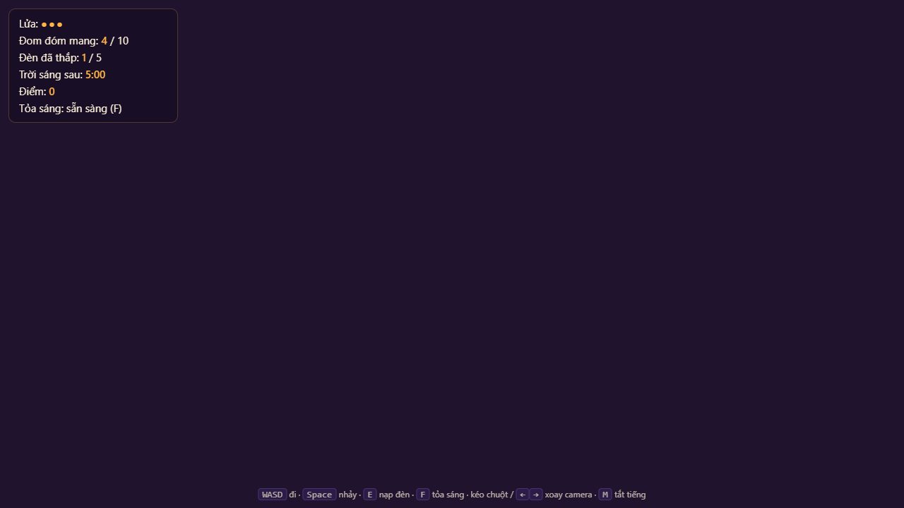

# Đảo Đèn Lồng

> **Video demo:** _(sẽ thêm ở Phase 4: Release `v1.0.0`)_
> Bài lab Day 12 AI SDLC, cá nhân: Lê Xuân Hà, MSSV 2A202603571. Tài liệu đề bài: [docs/lab/](docs/lab/README.md).

Game 3D góc nhìn thứ ba. **Mây**, người giữ đèn nhỏ tuổi đội nón lá, chạy khắp Đảo Bến gom đom đóm để thắp lại **5 Đèn Lồng Lớn** trước khi trời sáng, đồng thời né và xua **Bóng Mực** tím đen trong sương.



## Cài đặt và chạy (3 lệnh)

Cần Node.js ≥ 18 (macOS, Linux hoặc Windows).

```bash
npm ci
npm run build
npm start          # mở http://localhost:5173
```

Không cần server: có thể mở thẳng `dist/web/index.html` bằng trình duyệt.

## Điều khiển

| Phím | Hành động |
|---|---|
| `W A S D` / mũi tên lên-xuống | Đi theo hướng camera |
| `Space` | Nhảy |
| `E` | Nạp đom đóm vào Đèn Lồng gần nhất (trong 3 m) |
| `F` | Tỏa sáng: tốn 1 đom đóm, làm choáng và đẩy lùi Bóng Mực trong 6 m |
| Kéo chuột / `←` `→` | Xoay camera |
| `Enter` / `R` / `M` | Bắt đầu / chơi lại / tắt tiếng |

## Luật chơi và cách tính điểm

- Đom đóm được nhặt tự động khi đi qua (bán kính 1.5 m), mang tối đa 10 con.
- Mỗi Đèn Lồng cần 5 đom đóm. Bấm `E` khi đứng trong 3 m để nạp (nạp được một phần).
- Bóng Mực đuổi theo với tốc độ 4 m/s (Mây chạy 6 m/s). Bị chạm: mất 1 **lửa** (có 3), rơi mất một nửa số đom đóm đang mang (làm tròn xuống), sau đó bất tử 1.5 s.
- Tỏa sáng (`F`): hồi chiêu 2 s. Bóng Mực trong 6 m bị choáng 3 s và bị đẩy lùi 4 m. Bóng Mực đang choáng không gây sát thương.
- Bóng Mực **không vào được** vùng 6 m quanh đèn **đã thắp**. Đèn đã thắp là chỗ trú an toàn.
- **Thắng:** thắp đủ 5 đèn. **Thua:** hết lửa, hoặc trời sáng (hết 300 s).

| Sự kiện | Điểm |
|---|---|
| Nhặt 1 đom đóm | +10 |
| Thắp 1 đèn | +100 |
| Mỗi Bóng Mực bị choáng bởi một lần tỏa sáng | +20 |
| Khi thắng: mỗi giây còn lại (làm tròn xuống) | +2 |
| Khi thắng: mỗi lửa còn lại | +50 |

## Chế độ headless (Test Contract v1.0)

Khai báo ở [`game.contract.json`](game.contract.json). Sau `npm ci && npm run build`:

```bash
node dist/headless.cjs --seed 42 --night 1 --ticks 600 --out out.jsonl \
  [--scenario scenario.json] [--inputs inputs.json] [--snapshot-every 10]
```

- 60 tick/s cố định, không cửa sổ, không GPU. Dừng sau `--ticks` bước hoặc khi game kết thúc. Thoát với mã `0`.
- File inputs/scenario sai định dạng (JSON hỏng, tick không tăng, `move` ngoài [-1, 1], id đèn lạ…) thoát với mã `2`. Tham số dòng lệnh sai thoát với mã `1`. Thông báo lỗi ghi ra stderr.
- Output JSONL gồm snapshot, event và dòng `end` cuối cùng. Snapshot có thêm mảng `motes` (khuyến nghị của v1.0).
- Tất định: dùng PRNG `mulberry32(seed)`, không dùng `Math.random`. Cùng seed, scenario và inputs cho output giống hệt nhau, kể cả id tự sinh (`M1…`, `S1…`).

Ghi chú về `tuning`:
- Mọi khái niệm trong contract đều có trong game nên không có giá trị `null`.
- `fall_enabled: false`: mép đảo là tường, không rơi được, nên không bao giờ có event `player_hit` với `by: "fall"`.
- Không có `dash` (trường `dash` trong inputs được chấp nhận nhưng bỏ qua).
- Các số ngoài contract (bán kính đảo 40 m, vị trí đèn, trọng lực, số đom đóm/Bóng Mực mặc định, nhịp sinh) nằm ở `WORLD` trong [`src/sim/tuning.ts`](src/sim/tuning.ts) và [docs/notes/phase-1.md](docs/notes/phase-1.md).

## Test và kiểm chứng

```bash
npm test          # build + typecheck + unit test + test CLI + mọi scenario headless
npm run verify    # chạy scenario qua lệnh headless thật, ghi bằng chứng vào docs/proof/phase-N/
node scripts/screenshot.mjs   # ảnh chụp game (Chrome/Edge headless)
```

- Scenario: [`tests/scenarios/phase-1/`](tests/scenarios/phase-1/). Báo cáo bằng chứng: [`docs/proof/phase-1/report.md`](docs/proof/phase-1/report.md).
- CI (GitHub Actions, Ubuntu + macOS) chạy test, verify, rồi `git diff --exit-code docs/proof` để chắc bằng chứng đã commit khớp với mã.

## Cấu trúc

```text
src/sim/      luật game thuần, tất định (dùng chung cho headless và bản web)
src/cli/      lệnh headless
src/web/      bản 3D Three.js (chỉ hiển thị và âm thanh)
tests/        unit, CLI, scenario headless theo phase
scripts/      build, serve, verify, screenshot, hooks
docs/notes/   giả định, tiêu chí nghiệm thu, nhật ký AI, retro
docs/proof/   bằng chứng sinh tự động
AGENTS.md, CLAUDE.md, .claude/   harness AI (hướng dẫn, hooks, skill)
```

## Sáng tạo của tôi

Mọi phần dưới đây chỉ nằm trong `src/web/`. Luật game ở `src/sim/` không biết tới chúng, nên output headless không đổi: bộ scenario và kiểm tra tất định vẫn đạt nguyên vẹn.

1. **Đom đóm dẫn đường:** khi Mây đang mang đom đóm, một mũi tên vàng trên đầu chỉ về Đèn Lồng chưa thắp gần nhất.
2. **Âm thanh tạo bằng code (WebAudio, không dùng file):** tiếng "ting" nhặt đom đóm cao dần theo số đang mang, hợp âm khi thắp đèn, tiếng trầm khi bị chạm, giai điệu thắng/thua.
3. **Đảo sáng dần:** mỗi đèn thắp làm bầu trời, sương và ánh sáng môi trường ấm lên. Đèn thắp hiện vòng sáng đúng bằng `safe_radius` để người chơi thấy chỗ trú.

Bằng chứng: [`docs/proof/phase-1/screenshots/`](docs/proof/phase-1/screenshots/) (mũi tên dẫn đường và vòng an toàn trong `lantern-lit-hud.png`), cùng 16/16 scenario headless đạt trong [`report.md`](docs/proof/phase-1/report.md).

## Ghi chép

- Giả định, tiêu chí nghiệm thu và đánh giá Phase 1: [docs/notes/phase-1.md](docs/notes/phase-1.md)
- Nhật ký dùng AI và token: [docs/notes/ai-log.md](docs/notes/ai-log.md)
- Giấy phép: [LICENSE](LICENSE) (MIT). Nguồn: [CREDITS.md](CREDITS.md)
